<div align="center">

# 📊 KhataAI

### WhatsApp Payment Extraction Pipeline

**WhatsApp payment messages → structured Google Sheets ledger → daily WhatsApp summary → live dashboard.**
Fully automatic, privacy-first, and built on the Model Context Protocol.


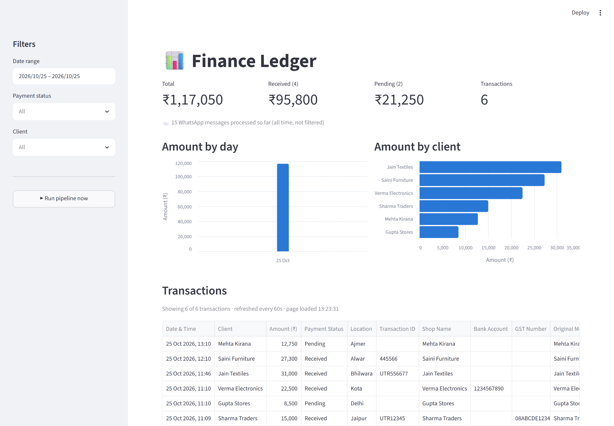

</div>

---

## 📑 Contents

- [What it does](#-what-it-does)
- [Proof: every step, captured from real runs](#-proof-every-step-captured-from-real-runs)
- [Architecture](#-architecture)
- [The LangGraph pipeline](#-the-langgraph-pipeline)
- [Reliability & privacy by design](#-reliability--privacy-by-design)
- [Evaluation](#-evaluation)
- [Project structure](#-project-structure)
- [Setup, step by step](#-setup-step-by-step)
- [Usage](#-usage)
- [Engineering challenges solved](#-engineering-challenges-solved)
- [Roadmap](#-roadmap)
- [Acknowledgments](#-acknowledgments)

---

## ✨ What it does

Small businesses run on WhatsApp: *"Sharma Traders, Jaipur received ₹15,000, UTR12345"*. This project turns that chat stream into accounting data, end to end:

| | Feature | How |
|---|---|---|
| 📥 | **Ingest** payment messages from finance groups | WhatsApp MCP server; only groups whose name contains `sales`, `payment`, `collection`, `finance`, … |
| 🧠 | **Extract** transactions from free text (English + Hinglish) | One LLM call per run (Groq · `qwen/qwen3.8-27b`), strict JSON validated with Pydantic |
| 📒 | **Write** a 10-column ledger to Google Sheets | Python computes the row range. The LLM never touches the Sheet |
| 🔁 | **Never duplicate, never lose** a message | SQLite dedup, plus "mark processed only after a successful write" |
| 📊 | **Daily summary** to WhatsApp at 21:00 | Plain Python math (no LLM), Indian number format (₹1,17,050) |
| 🖥️ | **Live dashboard** | Streamlit: KPIs, filters, charts, ledger table, "Run pipeline now" button |
| ⏰ | **Runs by itself** | Windows Task Scheduler: bridge at logon, ingestion every 30 min, summary daily |

🎬 **Demo video:** [watch the system in action](https://drive.google.com/drive/folders/105Q9rKh7aBOUda3tyjiN3v8ZWJrsp3cK?usp=sharing)

---

## 📸 Proof: every step, captured from real runs

All screenshots below come from this machine. Terminal images show the exact command output. Data is test data.

### 1️⃣ Payment messages arrive in a WhatsApp group

A group whose name contains a keyword ("Test Payments") is picked up automatically. Normal chat ("Good morning") is mixed in on purpose.

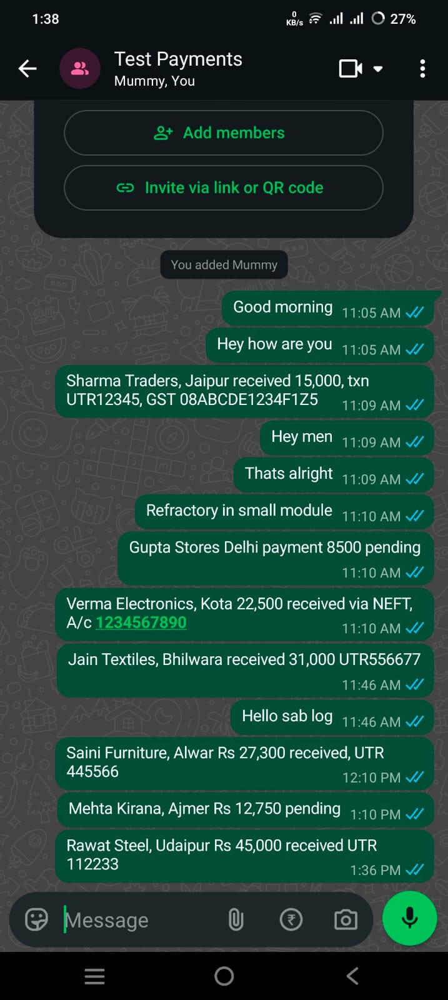

### 2️⃣ The pipeline extracts transactions

`client.py` runs the LangGraph pipeline. Here it runs on the bundled sample data in dry-run mode: 7 messages give 5 transactions. Greetings, a meeting note and a caption-less image are skipped, and one message holding **two** transactions gives two rows.

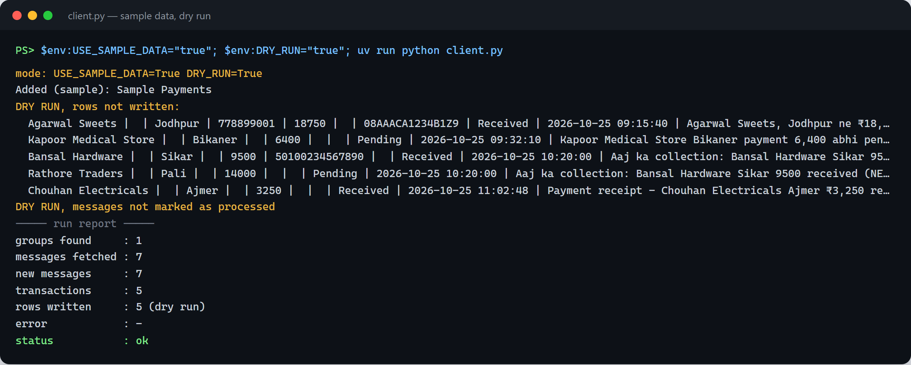

### 3️⃣ Rows land in the Google Sheets ledger

10 columns. **Date & Time** and **Original Message** are copied by Python from the source message (never typed by the LLM), so they are always exact and auditable.

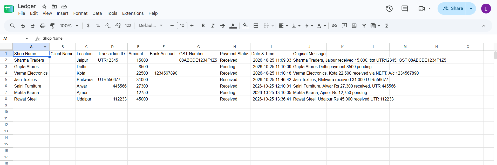

### 4️⃣ Failures are safe: nothing is lost, nothing is duplicated

With a deliberately wrong API key, the run does **not** crash. The graph routes to `END`, **no message is marked processed**, and the process exits with code `1`, so Task Scheduler shows a failure. The next good run retries the same messages.

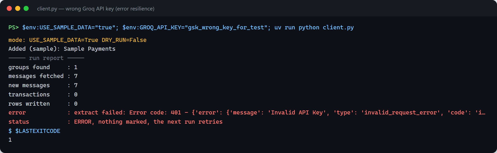

### 5️⃣ The daily summary is computed and sent to WhatsApp

`summary.py` reads the ledger, keeps today's rows and computes the totals in plain Python.

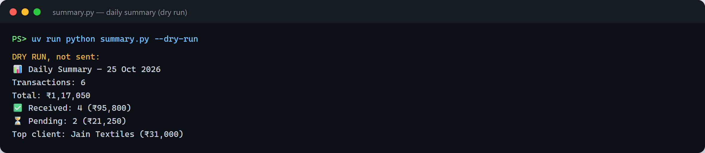

…and at 21:00 it arrives on WhatsApp:

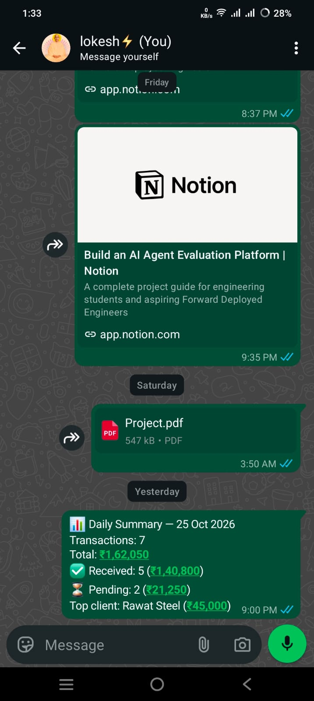

### 6️⃣ The dashboard shows everything live

KPIs, charts and the ledger, all following the sidebar filters. The totals use the **same function** as the WhatsApp summary, so they always match.

| Light | Dark |
|---|---|
|  | 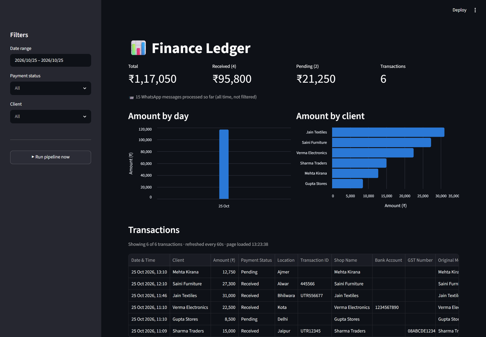 |

**Filtered to `Pending`:** what is still owed, at a glance.

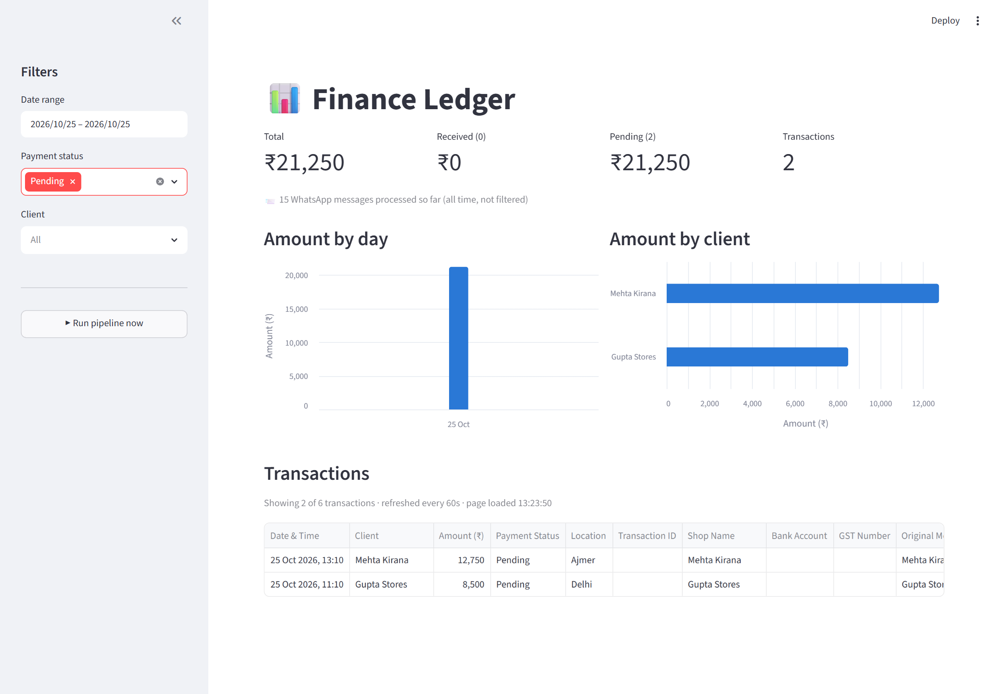

**"Run pipeline now"** runs the same LangGraph pipeline on demand and refreshes the page:

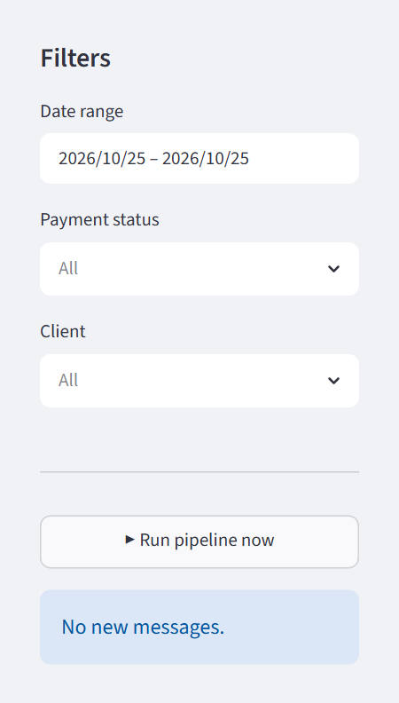

### 7️⃣ It runs by itself

Three Windows Task Scheduler tasks, created by one script (`scripts/register_tasks.ps1`, no admin needed):

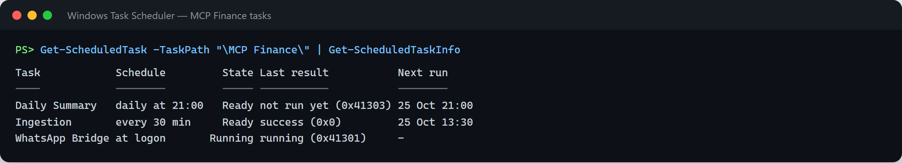

---

## 🏗️ Architecture

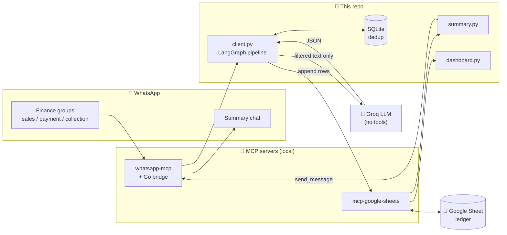

| Entry point | When it runs | What it does |
|---|---|---|
| `client.py` | Every 30 min (Task Scheduler), or the dashboard button | New WhatsApp messages → Sheet |
| `summary.py` | Daily at 21:00 (Task Scheduler) | Today's totals → WhatsApp |
| `dashboard.py` | When you open it | KPIs, filters, charts, ledger |

### v1 → v2: what changed

| | v1 | v2 (this version) |
|---|---|---|
| LLM's job | Called 8 Sheets tools itself: found the sheet, counted rows, computed ranges | **Only turns text into JSON.** Python does all I/O and arithmetic |
| Tools given to the LLM | 8 (and any returned tool name was executed) | **Zero** |
| Agent loop | `while True`, no limit | No loop: one LLM call, one retry on invalid JSON |
| Date & original message | Typed by the LLM | Copied by Python from the source message |
| When messages are marked | After any write, even partial | Only after a successful write. Errors mark nothing |
| Structure | One 150-line script | `core/` package + LangGraph graph with typed state |
| Outputs | Sheet | Sheet + WhatsApp summary + dashboard |

---

## 🔄 The LangGraph pipeline

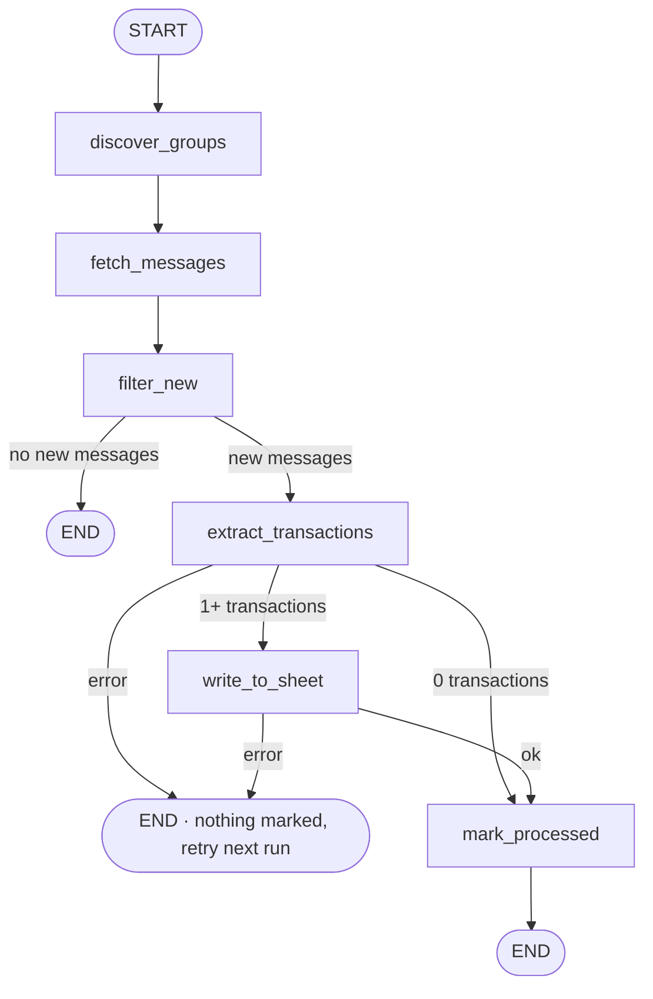

Each node calls one small function from `core/` and returns only the state keys it changes. The routers are plain `if/else`, so the path is predictable. All five paths are covered by tests:

| Path | Route | Marked processed? |
|---|---|---|
| New messages, transactions found | … → extract → write → mark | ✅ |
| No new messages | … → filter → END | not needed |
| LLM fails twice | … → extract → END | ❌ (retried next run) |
| Only chit-chat (0 transactions) | … → extract → mark | ✅ (not sent to the LLM again) |
| Sheet write fails | … → write → END | ❌ (retried next run) |

**Ledger columns:** `Shop Name · Client Name · Location · Transaction ID · Amount · Bank Account · GST Number · Payment Status · Date & Time · Original Message`. The LLM fills the first 8 and returns a `source` index, and Python fills the last 2 from that message.

---

## 🛡️ Reliability & privacy by design

**Privacy**
- 🔒 **The LLM gets no tools at all.** It cannot read chats, send messages or touch the Sheet. Only Python calls MCP tools.
- 🔒 Only messages from **keyword groups** that were **not processed before** leave the machine. Personal chats are never read.
- 🔒 Summary and dashboard numbers are computed locally.
- 🔒 The dashboard is bound to `localhost` (`.streamlit/config.toml`). Streamlit's default would expose it on the Wi-Fi network.
- 🔒 Secrets live in `.env` (git-ignored). `.env.example` documents the keys.

**Reliability**
- ✅ **Exactly-once ledger rows:** SQLite dedup, plus marking only after a successful write.
- ✅ **Single-run lock** (`data/pipeline.lock`): the scheduled run and the dashboard button can never ingest the same messages twice. A stale lock (>15 min) is replaced automatically.
- ✅ **Validated LLM output:** Pydantic schema (`amount` is a number, `status ∈ {Received, Pending, Unknown}`, `source` in range), one retry that includes the error, then a clean failure.
- ✅ **Feedback-loop guard:** `summary.py` refuses to post into a monitored group, because its own summary would be re-ingested as transactions.
- ✅ **Media-safe:** image messages without a caption never reach the LLM. v1 wrote a junk row for them.
- ✅ **Meaningful exit codes** for Task Scheduler (`0` ok / `1` error), and UTF-8 output so `₹` survives redirected logs.

---

## 📏 Evaluation

The extractor is scored against two hand-labelled sets of synthetic messages:

| Set | Messages | Use |
|---|---|---|
| `evals/dataset.jsonl` (dev) | 62 | Finding errors and tuning the prompt |
| `evals/heldout.jsonl` (held-out) | 30 | **Never used for tuning.** New names, cities and wording ("jama", "lac", "outstanding", "advance") |

Both cover English, Hinglish, multi-transaction messages, amount formats (`15k`, `1.5 lakh`, `2.75L`, `twelve thousand five hundred`), status wording, media captions, numbers that are *not* amounts (phone numbers, pincodes, bill numbers) and non-transactions.

```powershell
uv run python -m evals.run_evals --batch-size 5 --repeats 3                                  # dev set, current prompt
uv run python -m evals.run_evals --dataset evals/heldout.jsonl --prompt evals/prompts/v1.txt # held-out set, old prompt
```

Predicted transactions are paired with the labels per message, then every field is compared after normalisation (case and punctuation for names, `UTR:` prefixes for IDs, numeric equality for amounts). Reports go to `evals/reports/`.

**Results** (`qwen/qwen3.8-27b`, batch size 5, 3 runs each; the 3 runs gave identical scores):

| Prompt | Set | Precision | Recall | Field accuracy | Hallucinated fields | Messages fully correct |
|---|---|---|---|---|---|---|
| v1 | dev | 100% | 100% | 97.5% | 1.4% | 90.3% |
| v2 | dev | 98.3% | 100% | 100% | 0% | 98.4% |
| v1 | **held-out** | 100% | 100% | 94.8% | 2.9% | 80.0% |
| v2 | **held-out** | 96.7% | 100% | **100%** | **0%** | **96.7%** |

**What changed between v1 and v2** ([`evals/prompts/`](evals/prompts/)): on the dev set, 5 of v1's 6 failures were one pattern, a business name put in `client_name`. v2 defines `shop_name`, `client_name`, `location` and `status`. On the held-out set, field accuracy went from 94.8% to 100%.

**Known failure:** v2 reads a delivery or order message ("50 bori cement deliver karni hai") as a transaction, once in each set. A rule for it made other cases worse, so it was dropped.

**What the eval found in production:** with 20 messages in one call (the old behaviour), the request needed ~1,900 output tokens, above Groq's free-tier limit of 1,000 per minute, so it failed with `429` on every retry and the run never completed. Extraction now goes in chunks of `EXTRACT_BATCH_SIZE` (default 5) with rate-limit backoff.

Offline unit tests (no API key needed) cover the extractor and the scorer: `uv run pytest`.

---

## 🗂️ Project structure

```
Khata-AI/
├── client.py              # entry point: ingestion (runs the LangGraph pipeline)
├── summary.py             # entry point: daily WhatsApp summary
├── dashboard.py           # entry point: Streamlit dashboard
├── core/                  # shared logic (one Python package)
│   ├── config.py          #   .env, paths, MCP servers, load_tools()
│   ├── whatsapp.py        #   groups, messages, parse_message(), send_message()
│   ├── extractor.py       #   prompt → LLM → JSON → Pydantic
│   ├── sheets.py          #   read_ledger(), append_rows()
│   ├── db.py              #   SQLite dedup
│   ├── lock.py            #   single-run lock
│   └── graph.py           #   LangGraph state, nodes, routing, run_pipeline()
├── data/
│   ├── sample_messages.json   # offline test data
│   ├── processed_msg.db       # (git-ignored)
│   └── logs/                  # (git-ignored) client / summary / bridge logs
├── scripts/               # Windows Task Scheduler
│   ├── run_client.cmd · run_summary.cmd · run_bridge.cmd
│   ├── run_hidden.pyw     #   no console window, real exit code
│   └── register_tasks.ps1 #   creates the 3 tasks
├── evals/                 # labelled dataset, scorer, run_evals.py, reports/
├── tests/                 # offline unit tests (pytest)
├── docs/images/           # README screenshots
└── .env.example
```

---

## 🚀 Setup, step by step

> Tested on Windows 11 with Python 3.11 and `uv`.

### 1. Prerequisites

| Tool | Why |
|---|---|
| [uv](https://docs.astral.sh/uv/) | Python and dependencies |
| [Go](https://go.dev/dl/) | Builds the WhatsApp bridge |
| gcc (e.g. MSYS2 `mingw-w64-ucrt-x86_64-gcc`) | The bridge uses `go-sqlite3`, which needs CGO on Windows |
| A Google Cloud project | Sheets API + Drive API, service account |
| A [Groq](https://console.groq.com) API key | Free tier is enough |

### 2. Install

```powershell
git clone https://github.com/lokifergusion9/Khata-AI.git
cd Khata-AI
uv sync
```

### 3. WhatsApp MCP server

```powershell
git clone https://github.com/lharries/whatsapp-mcp ..\whatsapp-mcp
cd ..\whatsapp-mcp\whatsapp-bridge
go env -w CGO_ENABLED=1
go get go.mau.fi/whatsmeow@latest     # the pinned 2025 version fails with "Client outdated (405)"
go mod tidy
go build -o whatsapp-bridge.exe .
.\whatsapp-bridge.exe                 # scan the QR code: WhatsApp → Linked devices
```

> The latest `whatsmeow` adds a `context.Context` first argument to `client.Download`, `sqlstore.New`, `container.GetFirstDevice`, `client.GetGroupInfo` and `Store.Contacts.GetContact`. Pass `context.Background()` in `main.go`.

### 4. Google Sheets

1. Enable the **Google Sheets API** and **Google Drive API**.
2. Create a service account and download its JSON key. Keep it **outside** the repo.
3. Create a sheet with these headers in row 1:
   `Shop Name | Client Name | Location | Transaction ID | Amount | Bank Account | GST Number | Payment Status | Date & Time | Original Message`
4. Share the sheet with the service account email as **Editor**.

### 5. Configure `.env`

```powershell
copy .env.example .env
```

| Key | Example | Meaning |
|---|---|---|
| `GROQ_API_KEY` | `gsk_…` | LLM access |
| `GROQ_MODEL` | `qwen/qwen3.8-27b` | Any Groq chat model |
| `GOOGLE_APPLICATION_CREDENTIALS` | `C:/keys/sheets-key.json` | Service account key |
| `WHATSAPP_SERVER_DIR` | `C:/…/whatsapp-mcp/whatsapp-mcp-server` | Python MCP server folder |
| `SPREADSHEET_ID` | from the sheet URL | Ledger sheet |
| `SHEET_NAME` | `Sheet1` | Tab name |
| `MESSAGES_PER_GROUP` | `20` | Messages fetched per group per run |
| `EXTRACT_BATCH_SIZE` | `5` | Messages per LLM call (keeps each call under Groq's free-tier output limit) |
| `SUMMARY_CHAT_JID` | `91XXXXXXXXXX@s.whatsapp.net` | Where the summary goes (**not** a monitored group) |
| `USE_SAMPLE_DATA` / `DRY_RUN` | `false` | Offline development modes |

### 6. First run

```powershell
uv run python client.py              # WhatsApp → Sheet
uv run python summary.py --dry-run   # print today's summary
uv run streamlit run dashboard.py    # http://localhost:8501
```

### 7. Make it automatic (optional)

```powershell
powershell -ExecutionPolicy Bypass -File scripts\register_tasks.ps1
```

This creates *WhatsApp Bridge* (at logon), *Ingestion* (every 30 min) and *Daily Summary* (21:00) under `\MCP Finance\`. All tasks run on battery and show no window. Logs go to `data\logs\`.

---

## ▶️ Usage

| Command | What it does |
|---|---|
| `uv run python client.py` | One ingestion run, then prints a run report |
| `uv run python summary.py` | Sends today's summary to `SUMMARY_CHAT_JID` |
| `uv run python summary.py --dry-run --date 2026-10-25` | Prints the summary for any day |
| `uv run streamlit run dashboard.py` | Dashboard, with a "Run pipeline now" button |

**Offline mode.** Work on the code without WhatsApp or the Sheet:

```powershell
$env:USE_SAMPLE_DATA="true"; $env:DRY_RUN="true"; uv run python client.py
```

`USE_SAMPLE_DATA` reads `data/sample_messages.json`, and `DRY_RUN` prints rows instead of writing them and marks nothing. With both set, no MCP server is started at all.

---

## 🧩 Engineering challenges solved

- **LLM reliability:** moved the LLM from a tool-calling agent (wrong row counts, junk rows, unbounded loop) to a single validated extraction call.
- **Exactly-once processing:** dedup + commit-after-write + a cross-process lock.
- **Auditability:** every ledger row keeps the original message and its exact WhatsApp timestamp.
- **Structured extraction from messy chat:** Hinglish, several transactions per message, image captions, `₹`/`Rs`/comma amounts.
- **Upstream breakages, diagnosed and fixed:**
  - `whatsmeow` protocol update → `Client outdated (405)`: upgraded the library and patched 5 API calls.
  - `mcp-google-sheets@latest` crashes with `mcp` 2.x: pinned `--with "mcp<2"`.
  - The WhatsApp server's `get_chat(include_last_message=False)` has broken SQL: the default is used instead.
  - `list_messages` returns each message 2–3 times by default: `include_context=False`.
- **Windows specifics:** `₹` crashing redirected output (`charmap`), hidden scheduled tasks that still report exit codes, and battery-safe task settings.
- **Thread safety:** short-lived SQLite connections, so the Streamlit button can run the pipeline.

---

## 🗺️ Roadmap

- Persistent MCP sessions (today each tool call starts the server, ~6 s)
- Message-ID based dedup instead of full-text dedup
- Optional allowlist for individual (non-group) chats
- Always-on listener instead of 30-minute polling

---

## 🙏 Acknowledgments

Built on two excellent open-source MCP servers:

- **WhatsApp MCP Server:** [lharries/whatsapp-mcp](https://github.com/lharries/whatsapp-mcp) (customized for this project: `whatsmeow` upgrade and API fixes)
- **Google Sheets MCP Server:** [xing5/mcp-google-sheets](https://github.com/xing5/mcp-google-sheets)
